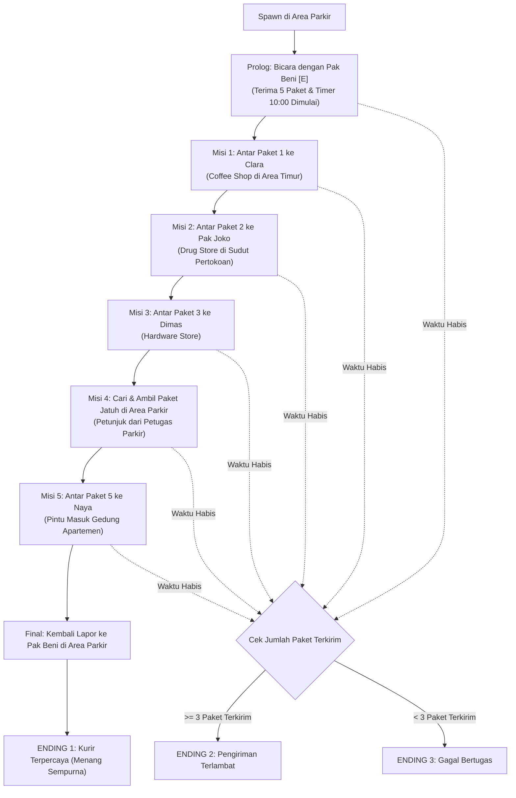

# Spesifikasi Desain: Game "Kurir Terakhir" (A City Delivery Adventure Game)

> **Mata Kuliah:** Introduction to Game Development  
> **Status:** Approved Spec  
> **Tanggal:** 2026-11-10  
> **Target Scene:** `Assets/Module 2.unity`  
> **Prinsip:** Ponytail (Minimal diff, YAGNI, No Over-engineering) & Antislop (Mode: During)

---

## 1. Ringkasan Eksekutif & Narasi (Story Overview)

Berdasarkan dokumen `History_Game_Kurir_Terakhir.docx`, game ini berlatar di sebuah kawasan perkotaan modern dengan deretan toko, apartemen, coffee shop, drug store, hardware store, dan area parkir yang sibuk. 

Rian adalah seorang kurir muda yang bekerja untuk layanan pengiriman lokal dan berstatus calon kurir tetap (*The Determined Rookie*). Suatu malam menjelang toko-toko tutup, Rian menerima satu tugas khusus: mengantarkan lima paket terakhir yang harus diterima malam itu juga. Jika seluruh paket sampai kepada penerima yang benar sebelum batas waktu berakhir, Rian akan resmi menjadi kurir tetap. Namun, label alamat pada paket terkena air hujan sehingga tidak terbaca jelas. Rian harus mengamati lingkungan kota, membaca papan nama bangunan, berbicara dengan NPC untuk mencari petunjuk, serta mengatasi rintangan mobil di jalan dan paket yang sempat terjatuh.

---

## 2. Parameter Gameplay & Mekanisme Inti

| Parameter | Spesifikasi |
|---|---|
| **Genre** | 3D Adventure, Exploration, Time Management |
| **Sudut Pandang** | Third-Person Follow Camera |
| **Batas Waktu** | 10 Menit (600 Detik) Countdown Timer |
| **Penalti Salah Kirim** | -20 detik per kesalahan pengiriman ke NPC yang salah |
| **Penalti Tabrakan Mobil** | -5 detik + Efek terdorong (*knockback*) dan tertahan sesaat (0.7s) |
| **Mekanisme Interaksi** | Tombol **[E]** saat berada dalam radius 2 meter dari NPC / paket jatuh |
| **Peta Kota** | Tombol **[M]** membuka overlay denah kota sederhana |
| **Total Paket** | 5 Paket bertahap + 1 Misi Pengambilan Paket Jatuh |

---

## 3. Alur Misi & Siklus Game (Game Loop)



---

## 4. Karakter & Detail Dialog NPC

### 1. Rian (Protagonist - Player)
- Menggunakan prefab `SimplePeople_Trucker_Black` dengan kendali WASD, Sprint (Shift), Lompat (Spasi), dan Interaksi ([E]).

### 2. Pak Beni (Petugas Pusat Pengiriman)
- **Lokasi:** Area Parkir samping mobil box kurir (X: 304, Z: -12).
- **Dialog Awal:**
  1. *"Rian! Ini lima paket terakhir untuk malam ini. Semua toko dan apartemen akan segera tutup."*
  2. *"Label alamat beberapa paket agak basah terkena hujan. Kamu harus membaca papan nama toko dan bertanya pada warga."*
  3. *"Waktumu 10 menit! Paket pertama harus sampai ke pegawai kedai kopi di trotoar timur sebelum mereka tutup."*
- **Dialog Akhir (Jika Selesai):**
  - *"Luar biasa, Rian! Semua paket telah sampai dengan selamat tepat waktu. Mulai besok, kamu resmi menjadi kurir tetap kami!"*

### 3. Clara (Pegawai Coffee Shop - Penerima Paket 1)
- **Lokasi:** Depan konter `Building_CoffeeShop` (X: 316, Z: 14).
- **Petunjuk Paket 1:** *"Label basah: 'C...ra' - Kedai kopi beraroma harum di deretan timur."*
- **Dialog:**
  1. *"Halo! Akhirnya paket biji kopi pesananku datang tepat sebelum kami tutup. Terima kasih banyak, Rian!"*
  2. *"Oh ya, tadi kulihat Pak Joko pemilik Drug Store sedang menunggu kiriman obat di deretan pertokoan barat."*

### 4. Pak Joko (Pemilik Drug Store - Penerima Paket 2)
- **Lokasi:** Depan toko obat `Building_StoreCorner_Drug` (X: 320, Z: 5).
- **Petunjuk Paket 2:** *"Label basah: 'Pak J...o' - Toko obat dan farmasi di sudut pertokoan."*
- **Dialog:**
  1. *"Terima kasih, Mas Rian! Pasokan obat ini sangat penting untuk warga besok pagi."*
  2. *"Kalau kamu mencari toko perkakas (Hardware Store), Dimas ada di toko sebelah barat jalan ini."*

### 5. Dimas (Pegawai Hardware Store - Penerima Paket 3)
- **Lokasi:** Depan `Building_Shop_01` (Hardware Store) (X: 308, Z: 7).
- **Petunjuk Paket 3:** *"Label basah: 'Di...s' - Toko perkakas dan hardware perkotaan."*
- **Dialog:**
  1. *"Wah pas sekali, obeng dan mur pesanan bengkel sudah sampai. Terima kasih kurir!"*
  2. *"Gawat Rian! Tadi saat kamu buru-buru menyeberang di area parkir, kulihat ada satu kotak paketmu yang terjatuh di dekat barisan mobil parkir!"*
  3. *"Cepat periksa area parkir dan tanya Petugas Parkir di sana sebelum paket itu terlindas!"*

### 6. Petugas Parkir (NPC Informasi Misi 4)
- **Lokasi:** Pos trotoar Area Parkir tengah (X: 298, Z: -5).
- **Dialog Misi 4:**
  1. *"Hei kurir! Paketmu tadi terlempar ke sela-sela mobil van merah di ujung parkiran saat kamu menghindari sedan putih."*
  2. *"Cepat ambil sebelum kendaraan lain keluar masuk!"*

### 7. Paket Terjatuh (Dropped Package 3D)
- **Lokasi:** Di sela mobil parkir (X: 294.5, Y: 0.05, Z: -8.0).
- **Visual:** Kardus 3D proporsional dengan penanda highlight halus. Tombol prompt `[E] Ambil Paket`.

### 8. Naya (Penghuni Apartemen - Penerima Paket 5)
- **Lokasi:** Lobi/Pintu masuk gedung apartemen `Building_OfficeLarge_Brown` (X: 288, Z: 18).
- **Petunjuk Paket 5:** *"Label basah: 'N...a' - Penghuni gedung apartemen bertingkat tinggi."*
- **Dialog:**
  1. *"Halo Mas Rian! Syukurlah paket dokumen pentingku sampai malam ini juga. Terima kasih atas kerja kerasmu!"*
  2. *"Sekarang cepatlah kembali ke pusat pengiriman di area parkir sebelum batas waktumu habis!"*

### 9. Warga Kota & Dialog Penolakan (Salah Kirim)
- Warga kota pejalan kaki / NPC lain jika didekati dengan tombol [E] saat pengiriman aktif:
  - *"Maaf mas, saya bukan penerima paket ini. Coba periksa papan nama toko dengan lebih teliti!"*
  - Mengurangi waktu **-20 detik** dengan indikator merah pada timer HUD.

---

## 5. Sistem UI & HUD (Antislop Compliant)

1. **Dashboard Catatan Pengiriman (Kiri Atas):**
   - Panel gelap beresolusi tinggi, kontras 4.5:1+, font Roboto-Bold tajam (dynamicPixelsPerUnit supersampling).
   - Indikator Timer: `⏱ 09:45` (Hijau/Putih saat normal, Kuning saat < 3 menit, Merah saat < 1 menit).
   - Status Paket: `📦 2/5 Terkirim`.
   - Kartu Catatan Aktif:
     - Nama Tujuan: `Temui Pak Joko (Drug Store)`.
     - Catatan Alamat: `Label agak basah: "Toko obat di sudut pertokoan"`.
2. **Tombol Interaksi Kontekstual ([E]):**
   - Muncul melayang tepat di tengah bawah saat pemain mendekati target:
     - `[E] Bicara dengan Pak Beni`
     - `[E] Serahkan Paket ke Clara`
     - `[E] Ambil Paket yang Terjatuh`
3. **Peta Kota Sederhana ([M]):**
   - Overlay peta denah kawasan kota berlabel nama area (Area Parkir, Coffee Shop, Drug Store, Hardware Store, Pertokoan, Apartemen) untuk navigasi mandiri tanpa panah GPS mengambang.
4. **Layar Akhir Permainan (Ending Modal):**
   - Teks judul ending besar berwibawa:
     - *ENDING 1: KURIR TERPERCAYA*
     - *ENDING 2: PENGIRIMAN TERLAMBAT*
     - *ENDING 3: GAGAL BERTUGAS*
   - Narasi epilog mendalam sesuai dokumen cerita.
   - Ringkasan statistik misi: Sisa Waktu, Paket Terkirim (X/5), Kesalahan Alamat.
   - Tombol `[Main Lagi (Restart)]` untuk mengulang permainan secara instan.

---

## 6. Hambatan Kendaraan & Deteksi Tabrakan

- Memanfaatkan mobil yang bergerak di jalan dan area parkir (`CityCarMover.cs`).
- Setiap mobil dilengkapi komponen `CarHazardTrigger`:
  - Mendeteksi sentuhan collider karakter Rian (`PlayerController`).
  - Menghasilkan dorongan mundur (*knockback physics*) menjauh dari badan mobil.
  - Memanggil `DeliveryGameManager.ApplyCarHitPenalty()`:
    - Pengurangan waktu **-5 detik**.
    - Efek goyah singkat (kecepatan jalan melambat 0.7 detik lalu pulih kembali).

---

## 7. Arsitektur Kode & Komponen Baru

```text
Assets/Scripts/
├── DeliveryGameManager.cs     # State machine misi, timer countdown, evaluasi ending, HUD binder
├── DeliveryHUD.cs             # Renderer UI kanvas (Timer, Catatan Paket, Prompt [E], Peta [M], Ending Modal)
├── DeliveryRecipient.cs       # Komponen penerima paket (Pak Beni, Clara, Pak Joko, Dimas, Naya, Petugas Parkir)
├── DroppedPackageItem.cs      # Objek paket 3D fisik yang dapat dipungut di area parkir
├── CarHazardTrigger.cs        # Deteksi tabrakan mobil dengan player (knockback & penalti waktu)
├── PlayerBootstrap.cs         # Titik masuk Play otomatis & pembersihan elemen modul tugas lama
└── ... (PlayerController, ThirdPersonCamera, NPCWalker, NPCDialogueOverlay tetap dipertahankan & diselaraskan)
```

---

## 8. Verifikasi & Pengujian (Testing Strategy)

1. **Uji Dialog & Alur Misi 1 s/d 5:**
   - Memastikan urutan misi berjalan berantai dari Pak Beni -> Clara -> Pak Joko -> Dimas -> Paket Jatuh -> Naya -> Pak Beni.
2. **Uji Penalti Waktu:**
   - Coba serahkan paket ke NPC yang salah: pastikan dialog penolakan muncul dan timer berkurang tepat 20 detik.
   - Sengaja tabrakkan diri ke mobil yang lewat: pastikan terjadi knockback dan timer berkurang tepat 5 detik.
3. **Uji 3 Ending:**
   - Selesaikan seluruh misi sebelum waktu habis -> Ending 1.
   - Biarkan waktu habis setelah 3-4 paket -> Ending 2.
   - Biarkan waktu habis sebelum 3 paket -> Ending 3.
4. **Uji Responsivitas & Performa:**
   - Canvas UI tajam kristal tanpa penurunan FPS.
   - Tombol [M] (Peta) dan [E] (Interaksi) responsif.
